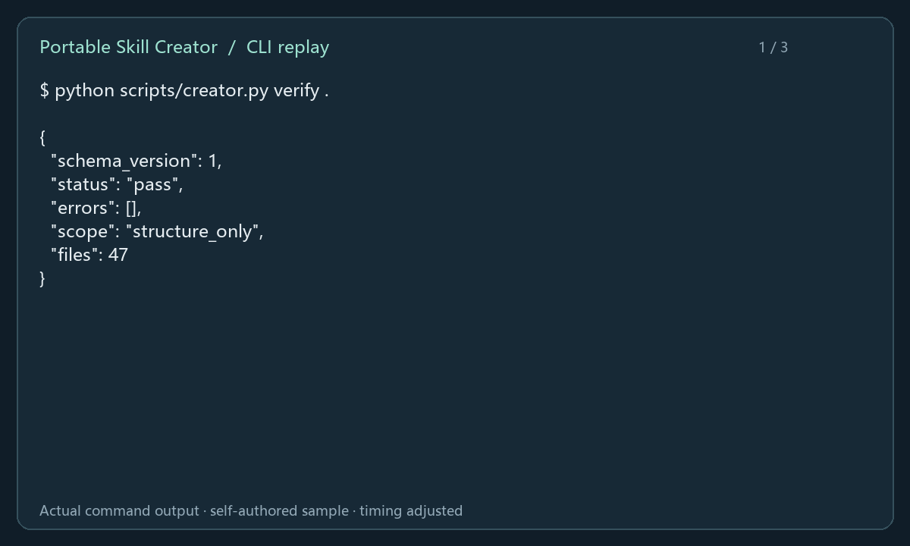
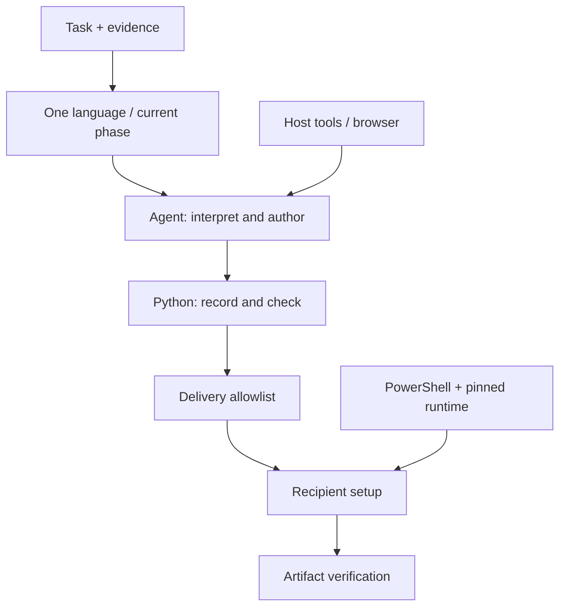

# Portable Skill Creator

[简体中文](README.md) · [Quick start](#quick-start) · [Command reference](references/en/commands.md)

**Turn real task experience into bilingual agent skills with explicit dependencies, recipient setup and verifiable outcomes.**


For skill authors sharing workflows with colleagues and other devices. The creator connects task evidence, dependency handling, environment preparation and acceptance. English and Chinese modules load by phase.

## See a delivery workflow



Actual execution on self-authored JSON input: structural validation → conversion → CSV output. The animation typesets captured stdout in order with adjusted hold times. View the [static result](docs/media/demo.png) or [text transcript](docs/demo.txt).

## Capabilities

| Stage | What it delivers |
|---|---|
| Capture | Agent-authored steps, dependencies, outcomes and recovery checkpoints |
| Audit | Source clues for paths, configuration, processes and platform requirements |
| Author | A compact router, language-specific modules, shared step IDs and contracts |
| Prepare | Real Python 3.12 detection and a pinned private runtime when needed |
| Distribute | Explicit file allowlists, installation hashes, conflict detection and rollback |
| Verify | Separate structural checks, observed task outcomes and supported combinations |

## Quick start

The initial target is **Windows 11 x64** with an agent that can read/write files and run commands. In PowerShell:

```powershell
git clone https://github.com/HNNUYUXUAN/portable-skill-creator.git
cd portable-skill-creator
$setup = & .\scripts\bootstrap.ps1 -Prepare
$python = ($setup | ConvertFrom-Json).python
& $python scripts/creator.py verify .
& $python scripts/creator.py export . "$HOME/.codex/skills/portable-skill-creator"
```

The installation destination must be new. For existing installs follow the [update procedure](references/en/update.md). First-time preparation uses uv 0.13.6 and Python 3.12.14; bootstrap's `-Python` argument can reuse a working 3.12 interpreter. Use the returned executable path. Follow local authorization procedures where script execution is restricted.

In a fresh Codex conversation:

> Use $portable-skill-creator to capture this task, then produce a distributable bilingual skill.

For WorkBuddy, put the exported directory at `.codebuddy/skills/portable-skill-creator` in a project and follow the [recipient guide](references/en/workbuddy.md).

## How it works



Instructions guide interpretation and authoring. Python helpers perform repeatable recording, checking and export. The host supplies file, terminal and optional browser capabilities; recipients configure their own service credentials.

The entrypoint budget is 4 KiB; each language module is limited to 8 KiB. Read the current language and phase, loading browser or update guidance when needed.

## Three runnable examples

- [Note triage](examples/note-triage/SKILL.md): organize explicitly marked items.
- [JSON → CSV](examples/json-to-csv/SKILL.md): sample input, converter and runtime preparation.
- [Page evidence](examples/page-evidence/SKILL.md): record facts and sources through the host browser.

## Validation and support

```powershell
& $python -B -m unittest discover -s tests -v
& $python scripts/creator.py verify .
```

Twelve local behavioral tests cover Unicode paths, input constraints, delivery exclusions, language pairs, redaction, recovery, updates and rollback. The [validation record](docs/validation.md) distinguishes this publication run from previous independent Codex and Chrome checks.

Version **0.1.0-dev** has local Windows 11 / Codex evidence. WorkBuddy, clean systems, separate devices and other models await independent validation. Model interfaces remain provider-neutral; outcomes are assessed per tested combination. Inspection is heuristic, doctor checks presence, and verify checks structure. Validate actual services and artifacts for each task.

## Documentation and contributions

Choose a language through [SKILL.md](SKILL.md). See [runtime sources](assets/sources.md) and [media provenance](docs/media/README.md). Issues and PRs with environment versions, reproduction steps and sanitized evidence are welcome.

Original code and documentation use the [MIT License](LICENSE). Downloaded runtimes retain their own licenses; the media page identifies the conceptual illustration and its usage.
