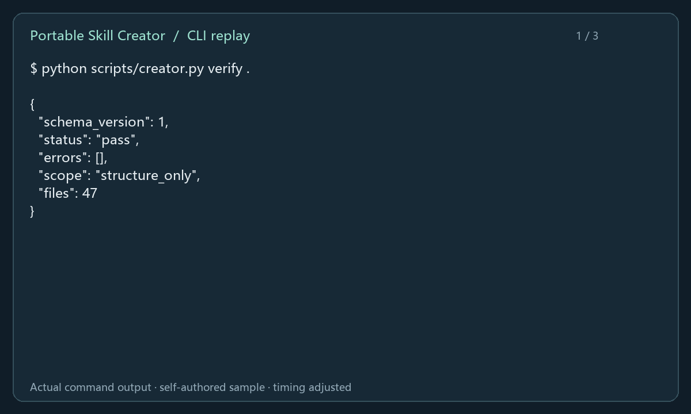
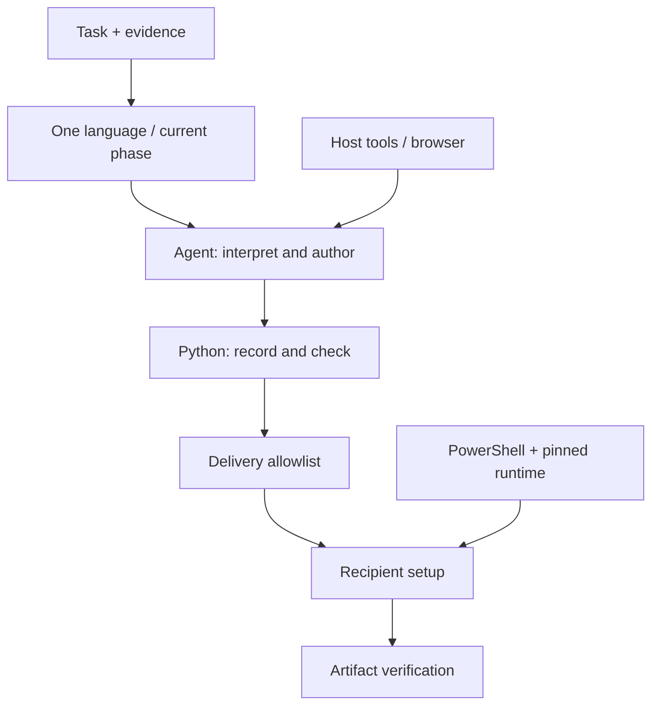

# Portable Skill Creator

[English](README.en.md) · [快速开始](#快速开始) · [命令参考](references/zh-CN/commands.md)

**把真实任务经验整理成可分发、可重建、可验收的双语 Agent 技能。**


适合希望把自己的工作流交给同事或其他设备使用的技能作者。创建器将任务证据、依赖清单、环境准备和结果检查组织到同一流程中；中文与英文模块按阶段读取。

## 看它完成一次交付



自建 JSON 样例的实际执行输出：结构检查 → 转换 → CSV 结果。动画由真实 stdout 顺序排版，停留时间经过调整；[静态结果](docs/media/demo.png)与[文本记录](docs/demo.txt)可单独查看。

## 核心能力

| 环节 | 交付能力 |
|---|---|
| 任务跟踪 | Agent 在执行时记录步骤、依赖、结果和检查点，中断后继续核对 |
| 依赖审计 | 识别源码中的路径、配置、进程与平台线索，逐项明确处理方式 |
| 双语编写 | 简短入口、按需语言模块，共用步骤 ID 和机器可读契约 |
| 环境准备 | 检测真实 Python 3.12；需要时用固定 uv 建立用户目录中的环境 |
| 分发维护 | 文件允许清单、安装指纹、修改冲突检测与版本回滚 |
| 验收 | 结构检查与实际任务结果分别记录，兼容范围有据可查 |

## 快速开始

首测环境为 **Windows 11 x64**，需要能读写文件和执行命令的 Agent。先在 PowerShell 中克隆并检查：

```powershell
git clone https://github.com/HNNUYUXUAN/portable-skill-creator.git
cd portable-skill-creator
$setup = & .\scripts\bootstrap.ps1 -Prepare
$python = ($setup | ConvertFrom-Json).python
& $python scripts/creator.py verify .
& $python scripts/creator.py export . "$HOME/.codex/skills/portable-skill-creator"
```

目标安装目录必须尚不存在。已有安装使用 [更新流程](references/zh-CN/update.md)。首次下载采用固定 uv 0.13.6 与 Python 3.12.14；已有可用 3.12 可通过 bootstrap 的 `-Python` 参数复用。解释器路径以命令输出为准。组织限制脚本执行时，请按本机授权流程处理。

在新 Codex 会话中调用：

> 使用 $portable-skill-creator 跟踪本次任务，结束后生成可分发的双语技能。

WorkBuddy 可将导出的技能目录放在项目的 `.codebuddy/skills/portable-skill-creator`，按[接收端说明](references/zh-CN/workbuddy.md)独立验收。

## 工作方式



通用指令负责任务理解与编写，Python 辅助程序负责可重复的记录、检查与导出。宿主提供文件、终端和必要的浏览器能力；云服务凭据由接收者配置。

入口上限为 4 KiB，每个语言模块上限为 8 KiB。只读取当前语言与当前阶段；需要浏览器或更新安装时再加载对应说明。

## 三个可运行样例

- [条目分类](examples/note-triage/SKILL.md)：按明确状态标记整理事项。
- [JSON → CSV](examples/json-to-csv/SKILL.md)：包含输入样例、转换脚本和运行时准备入口。
- [网页证据](examples/page-evidence/SKILL.md)：使用宿主浏览器记录页面事实及来源。

## 验证与适用范围

```powershell
& $python -B -m unittest discover -s tests -v
& $python scripts/creator.py verify .
```

本地 12 项行为测试覆盖中文路径、输入约束、分发排除、双语配对、记录脱敏、恢复、升级及回滚。[验证记录](docs/validation.md)区分本轮运行结果与此前的独立 Codex 和 Chrome 验收。

当前为 **0.1.0-dev**。Windows 11 / Codex 有本机证据；WorkBuddy、干净系统、异机和其他模型等待独立验证。模型接口保持中立，效果按实际组合评估。依赖扫描属于启发式检查，doctor 检查存在性，verify 检查结构；真实服务与最终产物由具体任务验收。

## 文档与贡献

从 [SKILL.md](SKILL.md) 选择语言模块。运行时与第三方来源见 [sources](assets/sources.md)，展示素材见[来源说明](docs/media/README.md)。欢迎提交带环境版本、复现步骤和脱敏证据的 Issue 或 PR。

原创代码与文档采用 [MIT License](LICENSE)。运行时下载保留各自许可；主题插画的身份与使用说明见素材来源页。
